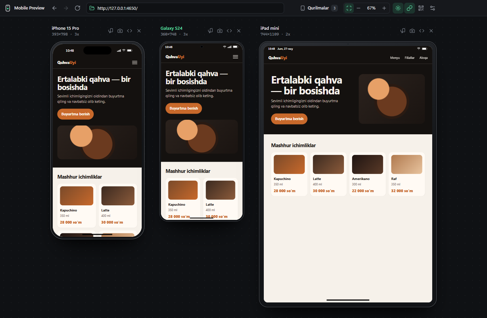
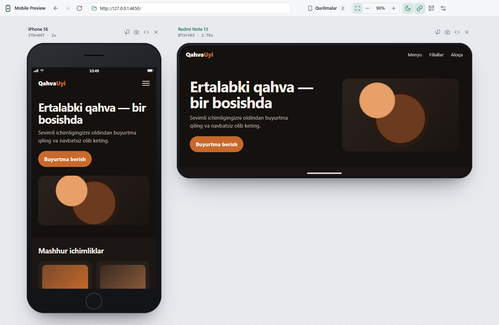
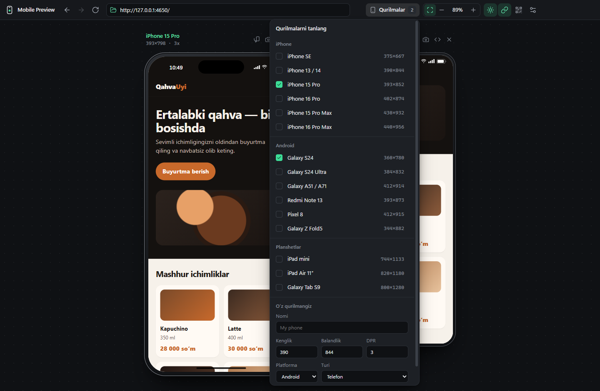
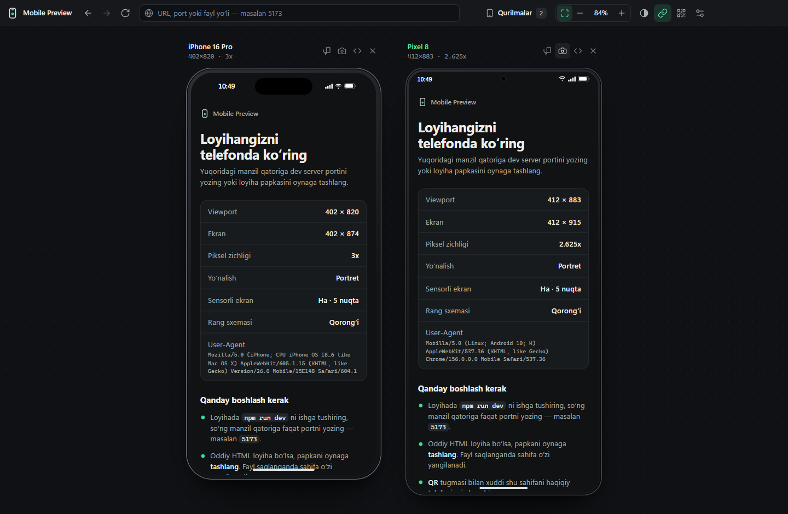
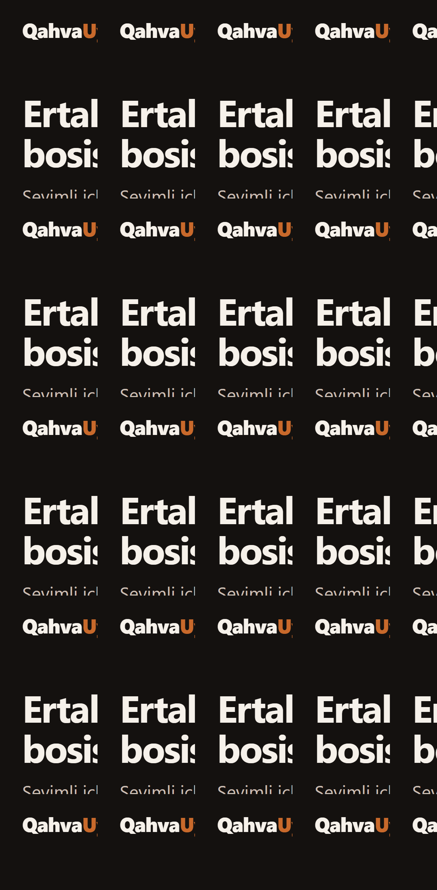
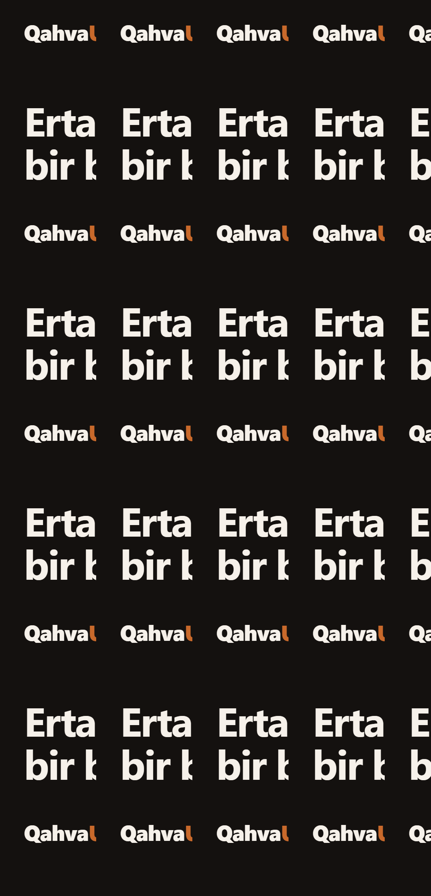
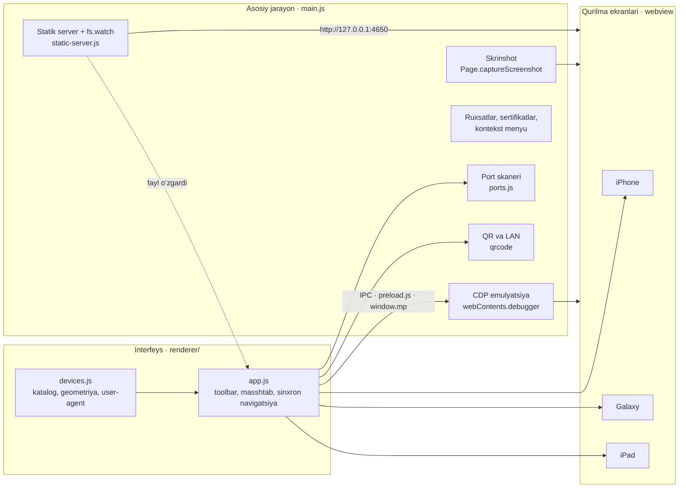

<div align="center">


# 📱 Mobile Preview — veb-loyihalar uchun telefon emulyatori

**Saytingiz iPhone, Samsung Galaxy, Redmi, Pixel va iPad ekranlarida qanday ko‘rinishini kompyuterning o‘zida, bir vaqtning o‘zida ko‘rsatadigan Windows ilovasi**

Haqiqiy qurilma emulyatsiyasi · Bir nechta qurilma yonma-yon · Dev serverni avtomatik topish · Live reload · QR orqali telefonda ochish · Asl o‘lchamdagi skrinshot


[](LICENSE)

**MyWeb × Nyrosoft**

[📥 Yuklab olish](#-yuklab-olish-va-ornatish) · [📋 Releases](https://github.com/ismoillooff/Mobile-Preview/releases) · [💬 Telegram: @ismoillooff](https://t.me/ismoillooff)

<br>

[](https://github.com/ismoillooff/Mobile-Preview/releases/latest/download/MobilePreview-Portable.exe)
&nbsp;
[-1F6FEB?style=for-the-badge&logo=windows&logoColor=white)](https://github.com/ismoillooff/Mobile-Preview/releases/latest/download/MobilePreview-Setup.exe)

</div>

<p align="center">
  
</p>

> Hujjat holati: README 2026-11-27 dagi kodga (v1.0.0) mos keladi.

---

## 📖 Loyiha haqida

**Mobile Preview** — frontend dasturchilar, dizaynerlar va QA mutaxassislari uchun Windows ilovasi. Siz yozayotgan sayt (Vite, React, Next.js, Vue, Angular, Django shablonlari yoki oddiy HTML) telefon va planshet ekranlarida qanday ko‘rinishini bitta oynada, bir nechta qurilmada birdaniga ko‘rsatadi.

Bu oddiy “kichraytirilgan brauzer oynasi” emas. Har bir ekran — Chromium’ning **DevTools Protocol** orqali boshqariladigan alohida ko‘rinish. Sahifaga qurilmaning haqiqiy **viewport** o‘lchami, **piksel zichligi (DPR)**, **user-agent**, **sensorli kiritish** va **ekran yo‘nalishi** beriladi. Shuning uchun media query’lar, `devicePixelRatio`, `(pointer: coarse)`, `(hover: none)`, `screen.orientation` va touch hodisalari xuddi telefondagidek ishlaydi.

### Kimlar uchun?

- **Frontend dasturchilar** — responsive sahifani har safar telefonga o‘tkazmasdan tekshirish uchun.
- **Dizaynerlar va QA** — bir xil sahifani bir nechta qurilmada yonma-yon solishtirish uchun.
- **Telegram Mini App va landing page yaratuvchilar** — mobil foydalanuvchi ko‘radigan natijani tez ko‘rish uchun.
- **Agentliklar** — mijozga qurilma ramkasi bilan chiroyli skrinshot yuborish uchun.

### Brauzer oynasini kichraytirishdan farqi

| Xususiyat | Oynani kichraytirish | Mobile Preview |
| --- | --- | --- |
| Viewport kengligi | Taxminiy | Qurilmaniki bilan bir xil (masalan, 393 px) |
| `devicePixelRatio` | Monitorniki (1–1.5) | Qurilmaniki (2, 2.75, 3, 3.75) |
| User-agent | Desktop brauzer | iOS Safari yoki Android Chrome |
| `(pointer: coarse)`, `(hover: none)` | Mos kelmaydi | Mos keladi |
| Touch hodisalari | Yo‘q | Bor (sichqoncha bilan sudrash = barmoq) |
| Ekran yo‘nalishi | Yo‘q | Portret / albom, `screen.orientation` |
| Bir nechta qurilma birdaniga | Yo‘q | Istalgancha |
| Qurilma ramkasi va status bar | Yo‘q | Dynamic Island, notch, punch-hole |

> [!IMPORTANT]
> Mobile Preview **veb-sahifalarni** emulyatsiya qiladi. U Android yoki iOS operatsion tizimini ishga tushirmaydi, shuning uchun native ilovalarni (APK/IPA) ochmaydi. iPhone ekranlari ham Chromium orqali chiziladi — Safari’ga xos render farqlarini yakuniy tekshirish uchun **QR** tugmasi bilan sahifani haqiqiy telefoningizda oching.

---

## 🧭 Mundarija

- [📥 Yuklab olish va o‘rnatish](#-yuklab-olish-va-ornatish)
- [✨ Imkoniyatlar](#-imkoniyatlar)
- [📸 Ko‘rinish](#-korinish)
- [📱 Qurilmalar katalogi](#-qurilmalar-katalogi)
- [🧱 Arxitektura](#-arxitektura)
- [🔄 Emulyatsiya qanday ishlaydi](#-emulyatsiya-qanday-ishlaydi)
- [💬 Foydalanish misollari](#-foydalanish-misollari)
- [⚡ Klaviatura yorliqlari](#-klaviatura-yorliqlari)
- [🧰 Texnologiyalar va talablar](#-texnologiyalar-va-talablar)
- [📂 Loyiha tuzilmasi](#-loyiha-tuzilmasi)
- [🚀 Manba koddan ishga tushirish](#-manba-koddan-ishga-tushirish)
- [🔧 Skriptlar va buyruqlar](#-skriptlar-va-buyruqlar)
- [💾 Sozlamalar va ma’lumotlar](#-sozlamalar-va-malumotlar)
- [🎨 Dizayn tizimi](#-dizayn-tizimi)
- [🌍 Lokalizatsiya](#-lokalizatsiya)
- [✅ Test va tekshiruv](#-test-va-tekshiruv)
- [🔐 Xavfsizlik va maxfiylik](#-xavfsizlik-va-maxfiylik)
- [🚧 Cheklovlar](#-cheklovlar)
- [🌿 Git va GitHub](#-git-va-github)
- [🧯 Muammolar va yechimlar](#-muammolar-va-yechimlar)
- [🧩 Rivojlantirish bo‘yicha tavsiyalar](#-rivojlantirish-boyicha-tavsiyalar)
- [👨‍💻 Muallif va aloqa](#-muallif-va-aloqa)
- [📄 Foydalanish huquqlari](#-foydalanish-huquqlari)
- [🇷🇺 Кратко по-русски](#-кратко-по-русски)
- [🇬🇧 English summary](#-english-summary)

---

## 📥 Yuklab olish va o‘rnatish

| Fayl | Turi | Hajmi | Qachon tanlash kerak |
| --- | --- | --- | --- |
| [**MobilePreview-Portable.exe**](https://github.com/ismoillooff/Mobile-Preview/releases/latest/download/MobilePreview-Portable.exe) | Portable | ~106 MB | O‘rnatmasdan darhol ishga tushirish uchun. Fleshkadan ham ishlaydi. |
| [**MobilePreview-Setup.exe**](https://github.com/ismoillooff/Mobile-Preview/releases/latest/download/MobilePreview-Setup.exe) | O‘rnatuvchi | ~116 MB | Start menyu va ish stoli yorlig‘i bilan doimiy o‘rnatish uchun. Tezroq ochiladi. |

Barcha versiyalar va reliz izohlari: **[Releases](https://github.com/ismoillooff/Mobile-Preview/releases)**.

**Tizim talablari:** Windows 10 yoki 11 (x64), ~400 MB bo‘sh joy. Node.js, brauzer yoki .NET kerak emas — hammasi ilova ichida.

### Portable versiya

1. `MobilePreview-Portable.exe` ni yuklab oling.
2. Ikki marta bosing — ilova o‘rnatishsiz ochiladi (birinchi ochilish bir necha soniya oladi: fayl vaqtinchalik papkaga ochiladi).

### O‘rnatuvchi (Setup)

1. `MobilePreview-Setup.exe` ni ishga tushiring.
2. O‘rnatish papkasini tanlang (standart: joriy foydalanuvchi uchun, administrator huquqi shart emas).
3. Ilova **Start** menyusida va ish stolida **Mobile Preview** nomi bilan paydo bo‘ladi.

> [!WARNING]
> EXE fayllar hozircha code-signing sertifikati bilan imzolanmagan. Birinchi ishga tushirishda Windows SmartScreen **“Windows protected your PC”** oynasini ko‘rsatishi mumkin. Davom etish uchun **More info → Run anyway** ni bosing. Faylni faqat shu repozitoriyning [Releases](https://github.com/ismoillooff/Mobile-Preview/releases) sahifasidan yuklab oling.

### Faylni tekshirish (SHA-256)

Reliz izohida har bir fayl uchun SHA-256 nazorat summasi berilgan. Yuklab olingan faylni PowerShell’da tekshiring:

```powershell
Get-FileHash .\MobilePreview-Portable.exe -Algorithm SHA256
```

### Yangilash

- **Portable:** eski `.exe` ni yangisi bilan almashtiring.
- **O‘rnatuvchi:** yangi `MobilePreview-Setup.exe` ni ishga tushiring — eski versiya ustidan o‘rnatiladi.

Sozlamalar, qurilmalar ro‘yxati va oxirgi ochilgan sahifalar yangilashda saqlanib qoladi.

### O‘chirish

- **O‘rnatuvchi versiya:** *Sozlamalar → Ilovalar → Mobile Preview → O‘chirish*.
- **Portable:** `.exe` faylini o‘chiring.
- Sozlamalarni ham to‘liq o‘chirish uchun `%APPDATA%\Mobile Preview` papkasini o‘chiring.

---

## ✨ Imkoniyatlar

### Emulyatsiya

- Viewport, DPR, `mobile` rejimi va ekran o‘lchami — `Emulation.setDeviceMetricsOverride` orqali.
- **User-agent:** iPhone/iPad uchun iOS Safari, Android uchun Chrome; Android’da client hints (`navigator.userAgentData`, qurilma modeli) ham beriladi.
- **Touch:** 5 nuqtali sensor; sichqoncha bilan sudrash barmoq bilan scroll qilishdek ishlaydi.
- **Yo‘nalish:** har bir qurilmani portret ↔ albom rejimiga burish; `screen.orientation` ham mos ravishda o‘zgaradi.
- **Sahifa mavzusi:** `prefers-color-scheme` ni yorug‘ / qorong‘i / tizim bo‘yicha almashtirish — Windows sozlamalariga tegmasdan.

### Qurilmalar va ramkalar

- 15 ta tayyor qurilma: 6 ta iPhone, 6 ta Android, 3 ta planshet — va istalgancha **o‘z qurilmangiz**.
- Realistik ramkalar: **Dynamic Island**, **notch**, **punch-hole** kamera, iPhone SE’ning **Home** tugmasi, yon tugmalar.
- **Status bar** (soat, aloqa, Wi-Fi, batareya) sahifaning `theme-color` meta tegi yoki fon rangiga avtomatik bo‘yaladi; matn rangi kontrastga qarab tanlanadi.
- **Home indicator** sahifa foniga qarab qora yoki oq bo‘ladi.
- Ramka va status barni sozlamalardan o‘chirib, toza viewport’ni ko‘rish mumkin.

### Loyihani ochish

- **Dev server:** manzil qatoriga bosilganda kompyuterdagi ishlayotgan serverlar (port, sahifa sarlavhasi va texnologiya: Vite, Next.js, Angular, Astro, SvelteKit, Django…) ko‘rsatiladi.
- **Faqat port:** `5173` yozsangiz `http://localhost:5173/` ochiladi; `:3000/admin` ham ishlaydi.
- **Papka yoki HTML fayl:** oynaga sudrab tashlang yoki menyudan tanlang. Ichki HTTP server orqali ochiladi, shuning uchun ES module, `fetch()` va `/css/...` kabi ildizdan boshlanadigan yo‘llar ishlaydi. Kengaytmasiz yo‘llar SPA uchun `index.html` ga qaytadi.
- **Live reload:** papkadagi fayl saqlanganda barcha qurilmalar o‘zi yangilanadi (`node_modules`, `.git` e’tiborga olinmaydi).
- **Oxirgi ochilganlar:** so‘nggi 8 ta manzil yoki papka eslab qolinadi.

### Ish jarayoni

- **Bir nechta qurilma yonma-yon**, har biri alohida sarlavha, o‘lcham va tugmalar bilan.
- **Sinxron navigatsiya:** bitta ekranda link bosilsa, qolganlari ham o‘sha sahifaga o‘tadi. Redirect va OAuth parametrlari qurilmalar orasida “ping-pong” bo‘lmaydi.
- **Masshtab:** 25% dan 150% gacha yoki **Moslash** — barcha qurilmalar oynaga avtomatik sig‘adi.
- **DevTools** har bir qurilma uchun alohida (F12); o‘ng tugma menyusida **Elementni tekshirish**, **Brauzerda ochish**, havoladan nusxa olish.
- Sahifa ochilmasa, qurilma ichida xato sababi va **Qayta urinish** tugmasi chiqadi.

### Natijani ulashish

- **Skrinshot — asl o‘lchamda:** iPhone 15 Pro uchun 1179×2394, Galaxy S24 uchun 1080×2244 piksel.
- **Skrinshot — ramka bilan:** mijozga yoki taqdimotga tayyor rasm.
- Skrinshotlar `Rasmlar\Mobile Preview` papkasiga saqlanadi va bildirishnomadan **Papkada ko‘rsatish** mumkin.
- **QR kod:** sahifani haqiqiy telefonda ochish uchun kompyuterning lokal tarmoq manzili bilan.

### Interfeys

- O‘zbek, rus va ingliz tillari.
- Qorong‘i, yorug‘ yoki tizim mavzusi; Windows oyna tugmalari mavzuga moslashadi.
- Oyna o‘lchami, qurilmalar, masshtab, til va boshqa barcha sozlamalar keyingi ochilishda tiklanadi.

---

## 📸 Ko‘rinish

| Yorug‘ mavzu, albom (landscape) rejimi | Qurilmalarni tanlash |
| :--- | :--- |
|  |  |

| Boshlang‘ich sahifa: qurilma nimani “ko‘radi” | Sozlamalar |
| :--- | :--- |
|  |  |

### Asl o‘lchamdagi skrinshot namunasi

Qurilma sarlavhasidagi 📷 tugmasi sahifani qurilmaning haqiqiy piksel o‘lchamida saqlaydi:

| iPhone 15 Pro — 1179 × 2394 | Galaxy S24 — 1080 × 2244 |
| :---: | :---: |
|  |  |

---

## 📱 Qurilmalar katalogi

| Qurilma | Viewport (CSS px) | DPR | Skrinshot o‘lchami | Ramka |
| --- | --- | --- | --- | --- |
| iPhone SE | 375 × 667 | 2 | 750 × 1334 | Home tugmasi |
| iPhone 13 / 14 | 390 × 844 | 3 | 1170 × 2532 | Notch |
| iPhone 15 Pro | 393 × 852 | 3 | 1179 × 2556 | Dynamic Island |
| iPhone 16 Pro | 402 × 874 | 3 | 1206 × 2622 | Dynamic Island |
| iPhone 15 Pro Max | 430 × 932 | 3 | 1290 × 2796 | Dynamic Island |
| iPhone 16 Pro Max | 440 × 956 | 3 | 1320 × 2868 | Dynamic Island |
| Galaxy S24 | 360 × 780 | 3 | 1080 × 2340 | Punch-hole |
| Galaxy S24 Ultra | 384 × 832 | 3.75 | 1440 × 3120 | Punch-hole |
| Galaxy A51 / A71 | 412 × 914 | 2.625 | 1082 × 2399 | Punch-hole |
| Redmi Note 13 | 393 × 873 | 2.75 | 1081 × 2401 | Punch-hole |
| Pixel 8 | 412 × 915 | 2.625 | 1082 × 2402 | Punch-hole |
| Galaxy Z Fold5 (tashqi ekran) | 344 × 882 | 2.625 | 903 × 2315 | Punch-hole |
| iPad mini | 744 × 1133 | 2 | 1488 × 2266 | Planshet |
| iPad Air 11″ | 820 × 1180 | 2 | 1640 × 2360 | Planshet |
| Galaxy Tab S9 | 800 × 1280 | 2 | 1600 × 2560 | Planshet |

> [!NOTE]
> Jadvaldagi o‘lchamlar — to‘liq ekran. Status bar yoqilganda sahifaga uning balandligi ayirib beriladi (masalan, iPhone 15 Pro: **393 × 798**, Galaxy S24: **360 × 748**), skrinshot ham shu viewport bo‘yicha olinadi. Aniq qiymat har bir qurilma nomi ostida ko‘rsatiladi. Albom rejimida telefonlarning status bari yashiriladi.

**O‘z qurilmangiz:** *Qurilmalar → O‘z qurilmangiz* bo‘limida nom, kenglik, balandlik, DPR, platforma (iOS / Android) va turni (telefon / planshet) kiriting. Platforma user-agent’ni, tur esa ramkani belgilaydi.

---

## 🧱 Arxitektura



| Qatlam | Fayllar | Vazifasi |
| --- | --- | --- |
| Asosiy jarayon | `src/main.js` | Oyna, CDP emulyatsiya, skrinshot, ruxsatlar, sertifikatlar, sozlamalarni saqlash, IPC |
| Xizmatlar | `src/main/static-server.js`, `src/main/ports.js` | Papkalar uchun HTTP server, live reload, LAN ulashish; dev serverlarni topish |
| Ko‘prik | `src/preload.js` | Renderer uchun tor va xavfsiz API (`window.mp`), `contextIsolation` bilan |
| Interfeys | `src/renderer/app.js`, `index.html`, `styles.css` | Toolbar, qurilma kartalari, popoverlar, masshtab, navigatsiya |
| Ma’lumotlar | `src/renderer/devices.js`, `i18n.js`, `icons.js` | Qurilmalar katalogi va ramka geometriyasi, tarjimalar, SVG ikonkalar |
| Boshlang‘ich sahifa | `src/renderer/start.html` | Qurilma ichida ko‘rinadigan diagnostika sahifasi |
| Vositalar | `scripts/make-icon.js`, `scripts/smoke.js` | Ikonka yaratish, avtomatik smoke test |

---

## 🔄 Emulyatsiya qanday ishlaydi

1. Har bir qurilma uchun sandbox qilingan `<webview>` **`about:blank`** bilan yaratiladi. Barcha qurilmalar bitta `persist:preview` sessiyasini bo‘lishadi — login va cookie hamma ekranda bir xil.
2. `dom-ready` hodisasida asosiy jarayon `webContents.debugger` orqali **Chrome DevTools Protocol 1.3** ga ulanadi.
3. `Emulation.setDeviceMetricsOverride` — viewport kengligi va balandligi, `deviceScaleFactor` (DPR), `mobile: true`, to‘liq ekran o‘lchami, `screenOrientation` va ko‘rinish masshtabi (`scale`) beriladi.
4. `Emulation.setTouchEmulationEnabled` (5 nuqta) va `Emulation.setEmitTouchEventsForMouse` — sichqoncha hodisalari touch hodisalariga aylanadi.
5. `Emulation.setUserAgentOverride` — iOS Safari yoki Android Chrome user-agent’i, Android uchun client hints metama’lumotlari bilan.
6. `Emulation.setEmulatedMedia` — `prefers-color-scheme` (yorug‘ / qorong‘i / tizim).
7. **Shundan keyingina** kerakli sahifa yuklanadi — server birinchi so‘rovdanoq to‘g‘ri user-agent va viewport’ni ko‘radi.
8. **Masshtab:** ekran kengligi monitorning haqiqiy piksellariga yaxlitlanadi va aniq `scale` shundan hisoblanadi. Shu sababli 67% yoki 89% kabi kasr masshtablarda ham ekran chetida 1 pikselli chiziq qolmaydi.
9. Sahifa yuklangach `theme-color` va fon rangi o‘qiladi — status bar, home indicator va ekran foni shunga bo‘yaladi.
10. **Sinxron navigatsiya:** faqat foydalanuvchi qurilma ichida bosgan link yoki SPA marshruti boshqa qurilmalarga tarqatiladi. Ilovaning o‘zi boshlagan yuklashlar va ularning redirect’lari tarqatilmaydi.

---

## 💬 Foydalanish misollari

### Vite / React / Vue

```bash
npm run dev            # http://localhost:5173
```

Mobile Preview’da manzil qatoriga `5173` yozing yoki ro‘yxatdan **:5173** ni tanlang. Vite’ning hot reload’i barcha qurilmalarda bir vaqtda ishlaydi.

### Next.js

```bash
npm run dev            # http://localhost:3000
```

Manzil qatoriga `3000` yoki `localhost:3000/dashboard` kabi to‘liq yo‘lni yozing.

### Oddiy HTML/CSS loyiha

Loyiha papkasini oynaga **sudrab tashlang** yoki manzil qatoridan **Loyiha papkasini ochish…** ni tanlang. Papka `http://127.0.0.1:4650/` da ochiladi; faylni saqlaganingizda barcha qurilmalar o‘zi yangilanadi. Manzil qatoriga `C:\Projects\site\index.html` kabi yo‘lni ham yozish mumkin.

### Haqiqiy telefonda tekshirish

1. Telefon va kompyuter **bitta Wi-Fi tarmog‘ida** bo‘lsin.
2. Dev serverni tarmoqqa oching:

```bash
npm run dev -- --host                      # Vite
npx next dev -H 0.0.0.0                    # Next.js
python manage.py runserver 0.0.0.0:8000    # Django
```

3. Toolbar’dagi **QR** tugmasini bosing va telefon kamerasi bilan skanerlang (`localhost` avtomatik `192.168.x.x` ga almashtiriladi).

> [!TIP]
> Ochilgan papkalar uchun 2-qadam kerak emas: QR oynasi ochilganda Mobile Preview papkani lokal tarmoqqa o‘zi ulashadi va ilova yopilguncha ishlaydi.

### Mijozga ko‘rsatish uchun rasm

Qurilma sarlavhasidagi 📷 → **Ramkasi bilan** — qurilma ramkasi bilan PNG tayyor. **Faqat ekran** esa asl piksel o‘lchamidagi rasmni beradi (App Store / Play Market skrinshotlari uchun qulay).

### Qurilma sarlavhasidagi tugmalar

| Tugma | Amal |
| --- | --- |
| ↻ Burish | Portret ↔ albom rejimi |
| 📷 Skrinshot | Faqat ekran (asl o‘lcham) yoki ramka bilan |
| `</>` DevTools | Shu qurilma uchun Chrome DevTools |
| ✕ Olib tashlash | Qurilmani ekrandan olib tashlash |

---

## ⚡ Klaviatura yorliqlari

| Tugmalar | Amal |
| --- | --- |
| `Ctrl + L` | Manzil qatoriga o‘tish |
| `Ctrl + R` / `F5` | Barcha qurilmalarni qayta yuklash |
| `Ctrl + Shift + R` | Keshsiz qayta yuklash |
| `F12` | Tanlangan qurilma uchun DevTools |
| `Ctrl +` / `Ctrl −` | Kattalashtirish / kichraytirish |
| `Ctrl + 0` | Oynaga moslash |
| `Alt + ←` / `Alt + →` | Orqaga / oldinga |
| `↑` / `↓`, `Enter`, `Esc` | Manzil qatori takliflari bo‘ylab yurish, ochish, yopish |

Yorliqlar qurilma ekrani ichida fokus bo‘lganda ham ishlaydi.

---

## 🧰 Texnologiyalar va talablar

| Texnologiya | Vazifasi |
| --- | --- |
| **Electron 45** (Chromium, Node.js) | Desktop ilova va `<webview>` ekranlar |
| **Chrome DevTools Protocol** | Qurilma emulyatsiyasi, touch, user-agent, rang sxemasi, skrinshot |
| **Node.js** `http`, `net`, `fs.watch` | Statik server, port skaneri, live reload |
| **qrcode** | QR kod yaratish |
| **HTML, CSS, JavaScript** | Interfeys — build bosqichisiz, framework’siz |
| **electron-builder** | Portable `.exe` va NSIS o‘rnatuvchi |

| Kim uchun | Talab |
| --- | --- |
| Foydalanuvchi | Windows 10 / 11 x64 |
| Dasturchi | Node.js 20+, npm, Git |
| EXE yig‘ish | Yuqoridagilar + qisqa papka yo‘li (NSIS cheklovi, [pastda](#-git-va-github)) |

---

## 📂 Loyiha tuzilmasi

```text
Mobile-Preview/
├── src/
│   ├── main.js                 # Asosiy jarayon: oyna, CDP emulyatsiya, skrinshot, IPC, ruxsatlar
│   ├── preload.js              # Renderer uchun xavfsiz ko‘prik (window.mp)
│   ├── main/
│   │   ├── ports.js            # Kompyuterdagi dev serverlarni topish
│   │   └── static-server.js    # Papkalar uchun HTTP server, live reload, LAN ulashish
│   ├── renderer/
│   │   ├── index.html          # Ilova oynasi
│   │   ├── styles.css          # Dizayn tokenlari, ramkalar, popoverlar
│   │   ├── app.js              # Interfeys mantiqi: qurilmalar, navigatsiya, masshtab
│   │   ├── devices.js          # Qurilmalar katalogi, ramka geometriyasi, user-agent
│   │   ├── i18n.js             # O‘zbek, rus va ingliz matnlari
│   │   ├── icons.js            # SVG ikonkalar
│   │   └── start.html          # Boshlang‘ich sahifa (qurilma ko‘rsatkichlari)
│   └── assets/icon.png         # Oyna ikonkasi (256 px)
├── scripts/
│   ├── make-icon.js            # Ikonkani SVG’dan yaratish
│   └── smoke.js                # Avtomatik smoke test
├── build/icon.png              # EXE ikonkasi (512 px)
├── docs/screenshots/           # README rasmlari
├── LICENSE                     # MIT litsenziyasi
├── SECURITY.md                 # Xavfsizlik siyosati
├── CONTRIBUTING.md             # Hissa qo‘shish tartibi
└── package.json                # Skriptlar va electron-builder sozlamalari
```

---

## 🚀 Manba koddan ishga tushirish

```bash
git clone https://github.com/ismoillooff/Mobile-Preview.git
cd Mobile-Preview
npm install
npm start
```

`npm install` Electron’ni (~110 MB) yuklab oladi. Ilova kodi build qilinmaydi — `src/` dagi fayllarni o‘zgartirib, ilovani qayta ochish kifoya. Ishlab chiqish rejimida `Ctrl + Shift + I` ilova oynasining o‘z DevTools’ini ochadi.

---

## 🔧 Skriptlar va buyruqlar

| Buyruq | Vazifasi |
| --- | --- |
| `npm start` | Ilovani ishlab chiqish rejimida ochish |
| `npm run dist` | Portable `.exe` va o‘rnatuvchini `dist/` ga yig‘ish |
| `npm run dist:portable` | Faqat portable `.exe` |
| `npm run dist:dir` | O‘rnatuvchisiz papka (`dist/win-unpacked`) — eng tez, sinov uchun |
| `npm run icon` | `build/icon.png` va `src/assets/icon.png` ni SVG’dan qayta yaratish |
| `npm run smoke -- <papka> [url]` | Avtomatik smoke test ([batafsil](#-test-va-tekshiruv)) |

---

## 💾 Sozlamalar va ma’lumotlar

| Nima | Qayerda |
| --- | --- |
| Sozlamalar | `%APPDATA%\Mobile Preview\settings.json` |
| Sahifalarning cookie, localStorage va keshi | `%APPDATA%\Mobile Preview\Partitions\preview` |
| Skrinshotlar | `%USERPROFILE%\Pictures\Mobile Preview` |

| Kalit | Standart qiymat | Vazifasi |
| --- | --- | --- |
| `lang` | `uz` | Interfeys tili: `uz`, `ru`, `en` |
| `theme` | `system` | Ilova mavzusi: `system`, `dark`, `light` |
| `scheme` | `auto` | Sahifa uchun `prefers-color-scheme`: `auto`, `light`, `dark` |
| `sync` | `true` | Sinxron navigatsiya |
| `frame` / `statusBar` | `true` / `true` | Qurilma ramkasi va status bar |
| `zoom` | `fit` | Masshtab: `fit` yoki `0.25`–`1.5` |
| `devices` | iPhone 15 Pro, Galaxy S24 | Ekrandagi qurilmalar va ularning yo‘nalishi |
| `customDevices` | `[]` | O‘zingiz qo‘shgan qurilmalar |
| `recent` / `last` | — | So‘nggi 8 ta manzil va oxirgi ochilgan sahifa |
| `window` | — | Oyna o‘lchami, joylashuvi va maksimallashganligi |

Ilova tashqi serverga hech qanday ma’lumot yubormaydi.

---

## 🎨 Dizayn tizimi

Tokenlar [`src/renderer/styles.css`](src/renderer/styles.css) boshida, `:root[data-theme]` bloklarida.

| Token | Qorong‘i | Yorug‘ | Qayerda |
| --- | --- | --- | --- |
| `--accent` | `#3ddc97` | `#0a7f50` | Asosiy tugmalar, faol holat, yuklanish chizig‘i |
| `--canvas` | `#0f1114` | `#e8eaee` | Qurilmalar turgan maydon (nuqtali fon) |
| `--panel` | `#16181c` | `#f6f7f8` | Toolbar |
| `--raised` | `#1d2025` | `#ffffff` | Popoverlar, bildirishnomalar |
| `--text` / `--text-2` / `--text-3` | `#e8eaed` / `#a8aeb8` / `#858c97` | `#15171a` / `#49505a` / `#626a75` | Matn darajalari (WCAG AA kontrast) |
| `--font` | Segoe UI Variable | Segoe UI Variable | Barcha interfeys matni |
| `--mono` | Cascadia Mono | Cascadia Mono | O‘lchamlar va texnik qiymatlar |

Ramka geometriyasi [`src/renderer/devices.js`](src/renderer/devices.js) dagi `FRAMES` obyektida (CSS px):

| Ramka | Qalinlik | Tashqi radius | Ekran radiusi | Status bar |
| --- | --- | --- | --- | --- |
| `island` (Dynamic Island) | 11 | 57 | 47 | 54 |
| `notch` | 11 | 53 | 43 | 47 |
| `punch` (Android) | 8 | 40 | 32 | 32 |
| `classic` (iPhone SE) | 15 / 74 | 54 | 0 | 20 |
| `tablet` | 20 | 38 | 18 | 24 |

Barcha o‘lchamlar masshtab o‘zgaruvchisi `--z` ga ko‘paytiriladi, shuning uchun ramka har qanday masshtabda proporsional qoladi.

---

## 🌍 Lokalizatsiya

| Qism | Fayl |
| --- | --- |
| Interfeys matnlari | `src/renderer/i18n.js` — `STRINGS.uz`, `STRINGS.ru`, `STRINGS.en` |
| Boshlang‘ich sahifa | `src/renderer/start.html` — ichki `S` obyekti |
| Kontekst menyu va ruxsat oynalari | `src/main.js` — `MENU_TEXT` va ruxsat matnlari |

Yangi til qo‘shish uchun uchala joyga ham tarjima qo‘shing va `i18n.js` dagi `LANGS` ro‘yxatiga tilni yozing. Kalit topilmasa, inglizcha matn ishlatiladi.

---

## ✅ Test va tekshiruv

### Avtomatik smoke test

```bash
npm run smoke -- .smoke                      # boshlang‘ich sahifa
npm run smoke -- .smoke 5173                 # dev server
npm run smoke -- .smoke C:\Projects\site     # papka
```

Ilova **fokusni olmasdan** ochiladi, sahifa yuklanishini kutadi, oyna va har bir qurilmaning asl o‘lchamdagi skrinshotini saqlaydi, `report.json` ga esa har bir qurilma “ko‘rgan” qiymatlarni yozadi va yopiladi. Smoke test vaqtinchalik profil ishlatadi — sizning sozlamalaringizga tegmaydi.

| O‘zgaruvchi | Vazifa |
| --- | --- |
| `MP_SMOKE_STATE` | Sozlamalarni JSON ko‘rinishida berish, masalan `{"devices":[{"id":"iphone-se","landscape":true}],"scheme":"dark"}` |
| `MP_SMOKE_DELAY` | Skrinshotdan oldin kutish, ms (standart 8000) |
| `MP_SMOKE_PRE_JS` | Skrinshotdan oldin oynada bajariladigan JavaScript |
| `MP_SMOKE_PRE_WAIT` | `MP_SMOKE_PRE_JS` dan keyin kutish, ms |

`report.json` namunasi (iPhone 15 Pro, v1.0.0):

```json
{
  "innerWidth": 393,
  "innerHeight": 798,
  "dpr": 3,
  "screen": "393x852",
  "touch": 5,
  "coarse": true,
  "hoverNone": true,
  "orientation": "portrait-primary",
  "shotSize": { "width": 1179, "height": 2394 }
}
```

### Tekshirilgan ssenariylar (v1.0.0)

| # | Ssenariy | Natija |
| --- | --- | --- |
| 1 | iPhone 15 Pro: viewport 393×798, DPR 3, iOS user-agent, 5 touch nuqta, `(pointer: coarse)`, `(hover: none)` | ✅ |
| 2 | Galaxy S24: 360×748, DPR 3, Android Chrome user-agent | ✅ |
| 3 | iPad mini: 744×1109, DPR 2, iPad user-agent | ✅ |
| 4 | Redmi Note 13 albom rejimida: 873×393, `landscape-primary` | ✅ |
| 5 | Papka ichki serverda: ES module, `fetch('/data.json')`, `/css/...` yo‘llari | ✅ |
| 6 | Live reload: fayl saqlangach barcha qurilmalar yangilandi | ✅ |
| 7 | Sinxron navigatsiya: bitta qurilmada link bosilganda ikkinchisi ham o‘tdi | ✅ |
| 8 | Sahifa mavzusi: `prefers-color-scheme: dark` / `light` almashdi | ✅ |
| 9 | Asl o‘lchamdagi skrinshot: 1179×2394 (iPhone), 1080×2244 (Galaxy) | ✅ |
| 10 | 5173-portdagi Vite serveri sarlavhasi va texnologiyasi bilan topildi | ✅ |
| 11 | QR: `localhost` lokal tarmoq IP manziliga almashtirildi | ✅ |
| 12 | Yig‘ilgan `.exe` ishga tushdi, emulyatsiya va muallif havolasi ishladi | ✅ |

### Qo‘lda tekshirish ro‘yxati

- [ ] Dev server (`npm run dev`) manzil qatori ro‘yxatida chiqadi
- [ ] Qurilmani burganda sahifa albom rejimiga o‘tadi
- [ ] Skrinshot `Rasmlar\Mobile Preview` papkasida paydo bo‘ladi
- [ ] QR telefonda ochiladi (bitta Wi-Fi’da)
- [ ] Til va mavzu almashtirilganda interfeys darhol yangilanadi

---

## 🔐 Xavfsizlik va maxfiylik

- Ko‘rilayotgan sahifalar Node.js’ga kirish huquqisiz, **sandbox** qilingan `<webview>` ichida ishlaydi; ilovaning o‘z oynasi boshqa sahifaga o‘ta olmaydi.
- Renderer `contextIsolation` bilan ishlaydi va faqat `preload.js` dagi tor API’dan foydalanadi.
- **Kamera, mikrofon, joylashuv va bildirishnomalar** uchun har bir saytdan alohida ruxsat so‘raladi.
- O‘z-o‘zidan imzolangan HTTPS sertifikatlar faqat `localhost` va lokal tarmoq manzillari (`192.168.*`, `10.*`, `172.16–31.*`) uchun qabul qilinadi.
- Papka serveri faqat `127.0.0.1` da ishlaydi va **faqat QR oynasi ochilganda** lokal tarmoqqa chiqadi; papkadan tashqaridagi fayllarga yo‘l yopiq.
- Ilova analitika yoki telemetriya yig‘maydi.

Zaifliklar haqida xabar berish tartibi: [SECURITY.md](SECURITY.md).

---

## 🚧 Cheklovlar

- Barcha qurilmalar **Chromium** (Blink) dvigatelida chiziladi. iPhone’dagi Safari (WebKit) render farqlari — masalan, ba’zi CSS xususiyatlari yoki shrift silliqlash — ko‘rinmaydi.
- Android yoki iOS native ilovalarini (APK/IPA) ochmaydi.
- Telegram Mini App ochilganda `window.Telegram.WebApp` obyekti bo‘lmaydi — faqat sahifa ko‘rinishi tekshiriladi.
- Dev server faqat keng tarqalgan 27 ta portda qidiriladi; boshqa portlarni qo‘lda yozing.
- Sinxron navigatsiyada SPA marshruti o‘zgarsa, boshqa qurilmalar sahifani to‘liq qayta yuklaydi (holat saqlanmaydi).
- Ramkali skrinshot monitor o‘lchamida olinadi; asl piksel o‘lchami faqat **Faqat ekran** rejimida.
- EXE hozircha raqamli imzosiz — SmartScreen ogohlantirishi chiqadi.
- Faqat Windows uchun yig‘iladi (kod macOS/Linux’da ham `npm start` bilan ishlashi mumkin, lekin sinovdan o‘tmagan).

---

## 🌿 Git va GitHub

`.gitignore` quyidagilarni repozitoriyga kiritmaydi:

| Fayl yoki papka | Sababi |
| --- | --- |
| `node_modules/` | npm paketlari (`npm install` bilan tiklanadi) |
| `dist/` | Yig‘ilgan `.exe` fayllar — ular Releases’ga yuklanadi |
| `.smoke/` | Smoke test natijalari |
| `*.log` | Loglar |

`.exe` fayllar 100 MB dan katta bo‘lgani uchun git’ga emas, **GitHub Releases** ga yuklanadi. Yangi reliz chiqarish:

```bash
# 1. package.json dagi "version" ni oshiring, masalan 1.0.1
npm run dist
gh release create v1.0.1 dist/MobilePreview-Portable.exe dist/MobilePreview-Setup.exe \
  --title "Mobile Preview 1.0.1" --notes "O‘zgarishlar ro‘yxati"
```

Fayl nomlari versiyasiz bo‘lgani uchun README’dagi `releases/latest/download/...` havolalari har doim eng so‘nggi relizga olib boradi.

> [!NOTE]
> NSIS (o‘rnatuvchi yig‘uvchi) Windows’ning 260 belgilik yo‘l cheklovini qo‘llab-quvvatlamaydi. Loyiha juda chuqur papkada bo‘lsa, `extractAppPackage.nsh` topilmadi xatosi chiqadi — loyihani qisqa yo‘lga (masalan, `C:\src\Mobile-Preview`) ko‘chirib yig‘ing.

---

## 🧯 Muammolar va yechimlar

| Muammo | Sabab | Yechim |
| --- | --- | --- |
| `ERR_CONNECTION_REFUSED` | Dev server ishlamayapti yoki port noto‘g‘ri | `npm run dev` ni ishga tushiring, portni tekshiring va qurilma ichidagi **Qayta urinish** ni bosing |
| Dev server ro‘yxatda chiqmayapti | Port keng tarqalganlar ro‘yxatida yo‘q | Manzilni qo‘lda yozing: `localhost:PORT` |
| QR telefonda ochilmayapti | Boshqa Wi-Fi, dev server faqat `localhost` da yoki Firewall | Bitta tarmoqqa ulaning, `--host` bilan ishga tushiring, Windows Firewall’da portga ruxsat bering |
| Papkadagi saytda CSS/JS yuklanmayapti | Ichki papka ochilgan, `/css/...` yo‘llari ildizdan hisoblanadi | Loyihaning ildiz papkasini oching |
| `extractAppPackage.nsh` topilmadi | Papka yo‘li 260 belgidan uzun | Loyihani qisqa yo‘lga ko‘chiring |
| “Windows protected your PC” | EXE imzolanmagan | **More info → Run anyway** |
| Sahifa juda kichik | Ko‘p qurilma tanlangan, **Moslash** ularni kichraytirgan | Qurilmalar sonini kamaytiring yoki `Ctrl +` bilan kattalashtiring |
| Sayt desktop versiyani ko‘rsatyapti | Server user-agent’ni kesh qilgan | `Ctrl + Shift + R` bilan keshsiz yuklang |
| Login hamma qurilmada bir xil | Qurilmalar bitta sessiyani bo‘lishadi | Bu ataylab shunday; turli akkaunt uchun boshqa brauzer profilidan foydalaning |

---

## 🧩 Rivojlantirish bo‘yicha tavsiyalar

- Qurilmalar orasida sinxron scroll va klik.
- Tarmoq tezligini cheklash (Slow 3G / Fast 4G) va CPU sekinlashtirish.
- **Telegram Mini App rejimi:** `Telegram.WebApp` obyekti, mavzu ranglari va test `initData` bilan.
- Qurilmalar to‘plamlarini (preset) saqlash va bir bosishda almashtirish.
- Ramkali skrinshotni yuqori aniqlikda (2x/3x) olish.
- Avtomatik yangilanish (`electron-updater`) va code-signing sertifikati bilan imzolangan EXE.
- GitHub Actions: har bir tag uchun avtomatik build va reliz.

---

## 👨‍💻 Muallif va aloqa

Loyiha **[MyWeb](https://myweb.uz)** va **[Nyrosoft](https://nyrosoft.uz)** tomonidan ishlab chiqilgan.

O‘rnatish, sozlash, nosozliklarni hal qilish, yangi qurilma yoki imkoniyat qo‘shish bo‘yicha savollar bo‘lsa, dasturchi bilan bog‘laning yoki [Issues](https://github.com/ismoillooff/Mobile-Preview/issues) bo‘limida yozing. Biznesingiz uchun sayt, Telegram bot, Mini App yoki CRM kerak bo‘lsa ham murojaat qilishingiz mumkin.

| Aloqa | Ma’lumot |
| --- | --- |
| Dasturchi | **Hayotbek Ismoilov** |
| GitHub | [@ismoillooff](https://github.com/ismoillooff) |
| Telefon / WhatsApp | [+998 95 005 15 45](https://wa.me/998950051545) |
| Telegram | [@ismoillooff](https://t.me/ismoillooff) |
| Instagram | [@ismoillooff](https://instagram.com/ismoillooff) |
| LinkedIn | [ismoillooff](https://www.linkedin.com/in/ismoillooff) |
| MyWeb | [myweb.uz](https://myweb.uz) |
| Nyrosoft | [nyrosoft.uz](https://nyrosoft.uz) |

---

## 📄 Foydalanish huquqlari

Loyiha **[MIT litsenziyasi](LICENSE)** ostida tarqatiladi: kodni bepul ishlatish, o‘zgartirish va tarqatish mumkin, faqat mualliflik va litsenziya matni saqlanishi shart. Dastur “boricha” (as is) taqdim etiladi. Hissa qo‘shish tartibi: [CONTRIBUTING.md](CONTRIBUTING.md).

---

## 🇷🇺 Кратко по-русски

**Mobile Preview** — приложение для Windows, которое показывает, как ваш сайт выглядит на iPhone, Samsung Galaxy, Redmi, Pixel и iPad — сразу на нескольких устройствах. Эмуляция через Chrome DevTools Protocol: реальные viewport, DPR, user-agent, touch и ориентация. Умеет находить запущенные dev-серверы, открывать папки с live reload, показывать QR для открытия на реальном телефоне и делать скриншоты в исходном разрешении. Интерфейс на узбекском, русском и английском.

[Скачать portable .exe](https://github.com/ismoillooff/Mobile-Preview/releases/latest/download/MobilePreview-Portable.exe) · [Скачать установщик](https://github.com/ismoillooff/Mobile-Preview/releases/latest/download/MobilePreview-Setup.exe)

## 🇬🇧 English summary

**Mobile Preview** is a Windows app that shows how your website looks on iPhone, Samsung Galaxy, Redmi, Pixel and iPad screens — several devices side by side. Emulation runs through the Chrome DevTools Protocol, so pages get the real viewport, DPR, user agent, touch input and orientation. It discovers running dev servers, opens local folders with live reload, shows a QR code to open the page on a real phone, and saves screenshots at the device's native resolution. UI in Uzbek, Russian and English.

[Download portable .exe](https://github.com/ismoillooff/Mobile-Preview/releases/latest/download/MobilePreview-Portable.exe) · [Download installer](https://github.com/ismoillooff/Mobile-Preview/releases/latest/download/MobilePreview-Setup.exe)

---

<div align="center">

**📱 Mobile Preview** — saytingiz har qanday ekranda chiroyli ko‘rinishi uchun

MyWeb × Nyrosoft · Hayotbek Ismoilov · [github.com/ismoillooff](https://github.com/ismoillooff)

</div>
