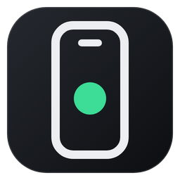
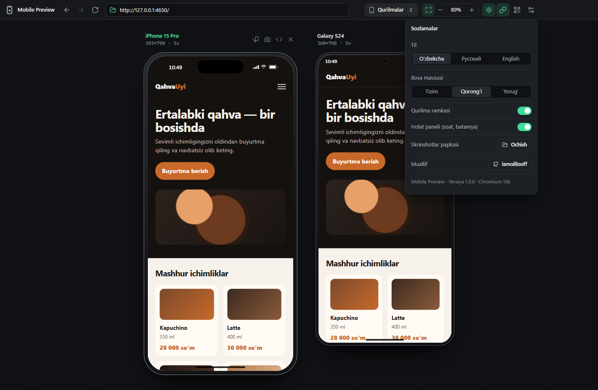
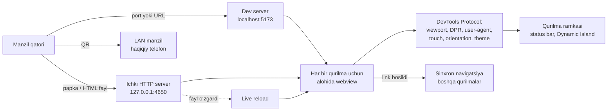

<div align="center">



# 📱 Mobile Preview

### Veb-loyihalaringiz telefon va planshetlarda qanday ko‘rinishini kompyuterning o‘zida ko‘rsatadigan Windows desktop emulyatori

[](#-yuklab-olish)
[](https://www.electronjs.org/)
[](https://chromedevtools.github.io/devtools-protocol/)
[](https://github.com/ismoillooff/Mobile-Preview/releases/latest)
[](LICENSE)

**Haqiqiy qurilma emulyatsiyasi · Bir nechta qurilma yonma-yon · Dev serverni avtomatik topish · Live reload · QR orqali haqiqiy telefonda ochish**

<br>

[](https://github.com/ismoillooff/Mobile-Preview/releases/latest/download/MobilePreview-Portable.exe)
&nbsp;
[-1F6FEB?style=for-the-badge&logo=windows&logoColor=white)](https://github.com/ismoillooff/Mobile-Preview/releases/latest/download/MobilePreview-Setup.exe)

</div>

<p align="center">
  
</p>

---

## 📌 Loyiha haqida

**Mobile Preview** — frontend dasturchilar va dizaynerlar uchun Windows ilovasi. Siz yozayotgan sayt (Vite, Next.js, React, oddiy HTML va boshqalar) **iPhone, Samsung Galaxy, Redmi, Pixel va iPad** ekranlarida qanday ko‘rinishini bitta oynada, bir vaqtning o‘zida ko‘rsatadi.

Bu oddiy “kichraytirilgan brauzer oynasi” emas. Har bir ekran Chromium’ning **DevTools Protocol** orqali boshqariladigan alohida ko‘rinishi bo‘lib, sahifaga qurilmaning haqiqiy **viewport** o‘lchami, **piksel zichligi (DPR)**, **user-agent**, **sensorli kiritish** va **ekran yo‘nalishi** beriladi. Shu sababli media query’lar, `devicePixelRatio`, `(pointer: coarse)`, `(hover: none)` va touch hodisalari xuddi telefondagidek ishlaydi.

**Kimlar uchun?** Responsive sayt, landing page, CRM yoki Telegram Mini App ustida ishlayotgan va natijani har safar telefonga o‘tkazmasdan tez tekshirmoqchi bo‘lgan dasturchilar uchun.

> [!IMPORTANT]
> Mobile Preview **veb-sahifalarni** emulyatsiya qiladi. U Android yoki iOS operatsion tizimini ishga tushirmaydi, shuning uchun native ilovalarni (APK/IPA) ocha olmaydi. Safari’ning o‘ziga xos render xususiyatlari ham Chromium orqali ko‘rsatiladi — yakuniy tekshiruv uchun **QR** tugmasi bilan sahifani haqiqiy telefoningizda oching.

## 📚 Mundarija

- [Yuklab olish](#-yuklab-olish)
- [Asosiy imkoniyatlar](#-asosiy-imkoniyatlar)
- [Qurilmalar ro‘yxati](#-qurilmalar-royxati)
- [Skrinshotlar](#-skrinshotlar)
- [Foydalanish](#-foydalanish)
- [Klaviatura yorliqlari](#-klaviatura-yorliqlari)
- [Ishlash jarayoni](#-ishlash-jarayoni)
- [Texnologiyalar](#-texnologiyalar)
- [Loyiha tuzilishi](#-loyiha-tuzilishi)
- [Manba koddan ishga tushirish](#-manba-koddan-ishga-tushirish)
- [EXE yig‘ish](#-exe-yigish)
- [Avtomatik smoke test](#-avtomatik-smoke-test)
- [Xavfsizlik va maxfiylik](#-xavfsizlik-va-maxfiylik)
- [Muammolar va yechimlar](#-muammolar-va-yechimlar)
- [Keyingi rivojlantirish g‘oyalari](#-keyingi-rivojlantirish-goyalari)
- [Litsenziya](#-litsenziya)
- [Ishlab chiquvchilar va aloqa](#-ishlab-chiquvchilar-va-aloqa)

---

## 📥 Yuklab olish

| Fayl | Turi | Hajmi | Qachon tanlash kerak |
| --- | --- | --- | --- |
| [**MobilePreview-Portable.exe**](https://github.com/ismoillooff/Mobile-Preview/releases/latest/download/MobilePreview-Portable.exe) | Portable | ~106 MB | O‘rnatmasdan, darhol ishga tushirish uchun. Fleshkada ham ishlaydi. |
| [**MobilePreview-Setup.exe**](https://github.com/ismoillooff/Mobile-Preview/releases/latest/download/MobilePreview-Setup.exe) | O‘rnatuvchi | ~116 MB | Start menyu va ish stoli yorlig‘i bilan doimiy o‘rnatish uchun. Tezroq ochiladi. |

Barcha versiyalar va SHA-256 nazorat summalari: **[Releases](https://github.com/ismoillooff/Mobile-Preview/releases)**.

**Tizim talablari:** Windows 10 yoki 11 (x64). Qo‘shimcha dastur (Node.js, brauzer, .NET) kerak emas.

> [!WARNING]
> EXE fayllar hozircha raqamli imzo (code-signing sertifikati) bilan imzolanmagan. Birinchi ishga tushirishda Windows SmartScreen **“Windows protected your PC”** oynasini ko‘rsatishi mumkin. Davom etish uchun **More info → Run anyway** ni bosing. Faylni faqat shu repozitoriyning Releases sahifasidan yuklab oling.

## ✨ Asosiy imkoniyatlar

| Imkoniyat | Tavsif |
| --- | --- |
| **Haqiqiy emulyatsiya** | Viewport, DPR, user-agent (iOS Safari / Android Chrome), touch, `screen.orientation`, safe-area — DevTools Protocol orqali. |
| **Realistik ramkalar** | Dynamic Island, notch, punch-hole kamera, Home tugmasi, soat va batareyali status bar, home indicator. |
| **Status bar rangi** | Sahifaning `theme-color` meta tegi yoki fon rangiga avtomatik moslashadi — xuddi telefondagidek. |
| **Bir nechta qurilma** | Istalgancha telefon va planshetni yonma-yon qo‘yish, har birini alohida burish yoki olib tashlash. |
| **Sinxron navigatsiya** | Bitta ekranda link bosilsa, qolgan qurilmalar ham o‘sha sahifaga o‘tadi (o‘chirib qo‘yish mumkin). |
| **Dev serverni topish** | Manzil qatoriga bosilganda 3000, 5173, 8000, 8080 va boshqa portlardagi Vite, Next.js, Angular, Astro, Django serverlari ko‘rsatiladi. |
| **Faqat port yozish** | `5173` yozsangiz kifoya — `http://localhost:5173/` ochiladi. |
| **Papka / HTML fayl** | Papka yoki faylni oynaga tashlang. U ichki HTTP server orqali ochiladi: ES module, `fetch()` va `/css/...` kabi yo‘llar ishlaydi. |
| **Live reload** | Ochilgan papkadagi fayl saqlanganda barcha qurilmalar avtomatik yangilanadi. |
| **Yorug‘ / qorong‘i rejim** | Sahifa uchun `prefers-color-scheme: light / dark` ni bir bosishda almashtirish — Windows sozlamalariga tegmasdan. |
| **QR orqali telefonda ochish** | Kompyuterning lokal tarmoq (LAN) manzili bilan QR kod. Papkalar so‘ralganda tarmoqqa ochiladi. |
| **Skrinshotlar** | Ekranning asl o‘lchamida (masalan, iPhone 15 Pro uchun 1179×2394) yoki qurilma ramkasi bilan. `Rasmlar\Mobile Preview` papkasiga saqlanadi. |
| **DevTools** | Har bir qurilma uchun alohida DevTools (F12) va o‘ng tugma → **Elementni tekshirish**. |
| **O‘z qurilmangiz** | Ixtiyoriy kenglik, balandlik, DPR, platforma (iOS / Android) va turi (telefon / planshet). |
| **3 til, 3 mavzu** | O‘zbekcha, ruscha, inglizcha interfeys; tizim, qorong‘i va yorug‘ mavzu. Barcha sozlamalar eslab qolinadi. |

## 📱 Qurilmalar ro‘yxati

| Qurilma | Viewport (CSS px) | DPR | Ramka |
| --- | --- | --- | --- |
| iPhone SE | 375 × 667 | 2 | Home tugmasi |
| iPhone 13 / 14 | 390 × 844 | 3 | Notch |
| iPhone 15 Pro | 393 × 852 | 3 | Dynamic Island |
| iPhone 16 Pro | 402 × 874 | 3 | Dynamic Island |
| iPhone 15 Pro Max | 430 × 932 | 3 | Dynamic Island |
| iPhone 16 Pro Max | 440 × 956 | 3 | Dynamic Island |
| Galaxy S24 | 360 × 780 | 3 | Punch-hole |
| Galaxy S24 Ultra | 384 × 832 | 3.75 | Punch-hole |
| Galaxy A51 / A71 | 412 × 914 | 2.625 | Punch-hole |
| Redmi Note 13 | 393 × 873 | 2.75 | Punch-hole |
| Pixel 8 | 412 × 915 | 2.625 | Punch-hole |
| Galaxy Z Fold5 (tashqi ekran) | 344 × 882 | 2.625 | Punch-hole |
| iPad mini | 744 × 1133 | 2 | Planshet |
| iPad Air 11″ | 820 × 1180 | 2 | Planshet |
| Galaxy Tab S9 | 800 × 1280 | 2 | Planshet |

Ro‘yxatda yo‘q qurilmani **Qurilmalar → O‘z qurilmangiz** bo‘limidan qo‘shish mumkin. Status bar yoqilganda sahifaga beriladigan balandlik undan kichikroq bo‘ladi (masalan, iPhone 15 Pro: 393 × 798) — qurilma nomi ostida aniq qiymat ko‘rsatiladi.

## 🖼️ Skrinshotlar

| Yorug‘ mavzu, albom (landscape) rejimi | Qurilmalarni tanlash |
| --- | --- |
|  |  |
| **Boshlang‘ich sahifa: qurilma nimani “ko‘rishi”** | **Sozlamalar** |
|  |  |

## 🚀 Foydalanish

### 1. Dev server bilan (Vite, Next.js, React, Vue…)

1. Loyihangizda dev serverni ishga tushiring, masalan `npm run dev`.
2. Mobile Preview’da manzil qatoriga bosing — ishlayotgan serverlar ro‘yxati chiqadi. Kerakligini tanlang yoki shunchaki portni yozing: `5173`.
3. Kod o‘zgarganda dev serverning o‘z hot reload’i barcha qurilmalarda ishlaydi.

### 2. Oddiy HTML loyiha

1. Loyiha papkasini (yoki `index.html` faylini) oynaga **sudrab tashlang** — yoki manzil qatoridagi **Loyiha papkasini ochish…** bandini tanlang.
2. Papka ichki server orqali `http://127.0.0.1:4650/` manzilida ochiladi.
3. Faylni saqlaganingizda sahifa barcha qurilmalarda **o‘zi yangilanadi**.

### 3. Haqiqiy telefonda tekshirish

1. Telefon va kompyuter **bitta Wi-Fi tarmog‘ida** bo‘lsin.
2. Yuqoridagi **QR** tugmasini bosing va telefon kamerasi bilan skanerlang.
3. Dev server tarmoqqa ochiq bo‘lishi kerak:

```bash
npm run dev -- --host          # Vite
npx next dev -H 0.0.0.0        # Next.js
python manage.py runserver 0.0.0.0:8000   # Django
```

> [!TIP]
> Ochilgan papkalar uchun buning hojati yo‘q: QR tugmasi bosilganda Mobile Preview papkani lokal tarmoqqa o‘zi ochadi.

### 4. Qurilma bilan ishlash

Har bir qurilma sarlavhasida 4 ta tugma bor: **burish** (portret ↔ albom), **skrinshot**, **DevTools** va **olib tashlash**. Yuqori panelda: qurilmalar ro‘yxati, masshtab (**Moslash** — oynaga avtomatik sig‘dirish), sahifa mavzusi, sinxron navigatsiya, QR va sozlamalar.

## ⌨️ Klaviatura yorliqlari

| Tugmalar | Amal |
| --- | --- |
| `Ctrl + L` | Manzil qatoriga o‘tish |
| `Ctrl + R` / `F5` | Barcha qurilmalarni qayta yuklash (`Shift` bilan — keshsiz) |
| `F12` | Tanlangan qurilma uchun DevTools |
| `Ctrl +` / `Ctrl −` | Kattalashtirish / kichraytirish |
| `Ctrl + 0` | Oynaga moslash |
| `Alt + ←` / `Alt + →` | Orqaga / oldinga |

## 🔄 Ishlash jarayoni



## 🧰 Texnologiyalar

| Texnologiya | Vazifasi |
| --- | --- |
| **Electron 45** (Chromium, Node.js) | Desktop ilova, `<webview>` ekranlar |
| **Chrome DevTools Protocol** | `Emulation.setDeviceMetricsOverride`, touch, user-agent, `prefers-color-scheme`, to‘liq o‘lchamdagi skrinshot |
| **Node.js `http` + `fs.watch`** | Papkalar uchun ichki statik server va live reload |
| **qrcode** | Telefonda ochish uchun QR kod |
| **HTML, CSS, JavaScript** | Interfeys — build bosqichisiz, framework’siz |
| **electron-builder** | Portable `.exe` va NSIS o‘rnatuvchi |

## 🗂️ Loyiha tuzilishi

```text
Mobile-Preview/
├── src/
│   ├── main.js                 # Asosiy jarayon: oyna, emulyatsiya, skrinshot, IPC, ruxsatlar
│   ├── preload.js              # Renderer uchun xavfsiz ko‘prik (window.mp)
│   ├── main/
│   │   ├── ports.js            # Kompyuterdagi dev serverlarni topish
│   │   └── static-server.js    # Papkalar uchun HTTP server, live reload, LAN
│   ├── renderer/
│   │   ├── index.html          # Ilova oynasi
│   │   ├── styles.css          # Dizayn tizimi: ranglar, ramkalar, popoverlar
│   │   ├── app.js              # Interfeys mantiqi: qurilmalar, navigatsiya, masshtab
│   │   ├── devices.js          # Qurilmalar katalogi, ramka geometriyasi, user-agent
│   │   ├── i18n.js             # O‘zbek, rus va ingliz matnlari
│   │   ├── icons.js            # SVG ikonkalar
│   │   └── start.html          # Boshlang‘ich sahifa (qurilma ko‘rsatkichlari)
│   └── assets/icon.png         # Oyna ikonkasi
├── scripts/
│   ├── make-icon.js            # Ilova ikonkasini SVG’dan yaratish
│   └── smoke.js                # Avtomatik smoke test
├── build/icon.png              # EXE ikonkasi (512 px)
├── docs/screenshots/           # README rasmlari
└── package.json                # Skriptlar va electron-builder sozlamalari
```

## 🛠️ Manba koddan ishga tushirish

**Talablar:** Node.js 20+ va npm.

```bash
git clone https://github.com/ismoillooff/Mobile-Preview.git
cd Mobile-Preview
npm install
npm start
```

## 📦 EXE yig‘ish

```bash
npm run dist            # Portable .exe + o‘rnatuvchi → dist/
npm run dist:portable   # Faqat portable .exe
npm run dist:dir        # O‘rnatuvchisiz papka (eng tez, sinov uchun)
npm run icon            # Ikonkani qayta yaratish
```

> [!NOTE]
> NSIS (o‘rnatuvchi yig‘uvchi) Windows’ning 260 belgilik yo‘l cheklovini qo‘llab-quvvatlamaydi. Loyiha juda chuqur papkada bo‘lsa `extractAppPackage.nsh` topilmadi xatosi chiqadi — loyihani qisqa yo‘lga (masalan, `C:\src\Mobile-Preview`) ko‘chirib yig‘ing.

## 🧪 Avtomatik smoke test

```bash
npm run smoke -- <natija_papkasi> [url_yoki_papka]
```

Ilova fokusni olmasdan ochiladi, sahifa yuklanishini kutadi, oyna va har bir qurilmaning to‘liq o‘lchamdagi skrinshotini saqlaydi hamda `report.json` ga har bir qurilma “ko‘rgan” qiymatlarni yozadi: `innerWidth`, `innerHeight`, DPR, user-agent, touch nuqtalari, `(pointer: coarse)`, `(hover: none)`, rang sxemasi va ekran yo‘nalishi. Smoke test vaqtinchalik profil ishlatadi — sizning sozlamalaringizga tegmaydi.

| O‘zgaruvchi | Vazifa |
| --- | --- |
| `MP_SMOKE_STATE` | Sozlamalarni JSON ko‘rinishida berish, masalan `{"devices":[{"id":"iphone-se","landscape":true}],"scheme":"dark"}` |
| `MP_SMOKE_DELAY` | Skrinshotdan oldin kutish (ms, standart 8000) |
| `MP_SMOKE_PRE_JS` | Skrinshotdan oldin oynada bajariladigan JavaScript |
| `MP_SMOKE_PRE_WAIT` | `MP_SMOKE_PRE_JS` dan keyin kutish (ms) |

## 🔒 Xavfsizlik va maxfiylik

- Ko‘rilayotgan sahifalar Node.js’ga kirish huquqisiz, **sandbox** qilingan `<webview>` ichida va alohida sessiyada (`persist:preview`) ishlaydi.
- Kamera, mikrofon, joylashuv va bildirishnoma so‘rovlari har bir sayt uchun **ruxsat so‘raladi**.
- O‘z-o‘zidan imzolangan HTTPS sertifikatlar faqat `localhost` va lokal tarmoq (192.168.x.x, 10.x.x.x) manzillari uchun qabul qilinadi.
- Papka serveri faqat `127.0.0.1` da ishlaydi va **faqat QR oynasi ochilganda** lokal tarmoqqa chiqadi.
- Ilova hech qanday ma’lumotni tashqi serverga yubormaydi; sozlamalar `%APPDATA%\Mobile Preview\settings.json` da saqlanadi.

Zaifliklar haqida xabar berish tartibi: [SECURITY.md](SECURITY.md).

## ❓ Muammolar va yechimlar

| Muammo | Yechim |
| --- | --- |
| **Sahifa ochilmadi** (`ERR_CONNECTION_REFUSED`) | Dev server ishlayotganini va port to‘g‘riligini tekshiring. Qurilma ichidagi **Qayta urinish** tugmasini bosing. |
| Dev server ro‘yxatda chiqmayapti | Faqat keng tarqalgan portlar tekshiriladi. Manzilni qo‘lda yozing: `localhost:PORT`. |
| Telefonda QR orqali ochilmayapti | Telefon va kompyuter bitta Wi-Fi’da ekanini, dev server `--host` bilan ishga tushganini va Windows Firewall portni bloklamaganini tekshiring. |
| Papkadagi saytda CSS/JS yuklanmayapti | Loyiha ildiz papkasini oching (faqat bitta HTML faylni emas) — `/css/...` kabi yo‘llar ildizdan hisoblanadi. |
| SmartScreen ogohlantirishi | **More info → Run anyway**. Sababi — EXE hali code-signing sertifikati bilan imzolanmagan. |
| Sahifa juda kichik ko‘rinadi | Masshtab tugmalari yoki `Ctrl +` dan foydalaning; **Moslash** barcha qurilmalarni oynaga sig‘diradi. |

## 📈 Keyingi rivojlantirish g‘oyalari

Quyidagilar **joriy versiyada yo‘q**, ammo keyingi versiyalarda foydali bo‘lishi mumkin:

- Qurilmalar orasida sinxron scroll va klik;
- Tarmoq tezligini cheklash (3G / 4G emulyatsiyasi);
- Telegram Mini App rejimi (Telegram WebApp mavzusi va `initData` bilan);
- Qurilmalar to‘plamlarini (preset) saqlash;
- Avtomatik yangilanish (auto-update) va raqamli imzolangan EXE.

## 📄 Litsenziya

Loyiha **[MIT litsenziyasi](LICENSE)** ostida tarqatiladi. Hissa qo‘shish tartibi: [CONTRIBUTING.md](CONTRIBUTING.md).

## 👨‍💻 Ishlab chiquvchilar va aloqa

Loyiha **[MyWeb](https://myweb.uz)** va **[Nyrosoft](https://nyrosoft.uz)** tomonidan ishlab chiqilgan.

O‘rnatish, sozlash, xatolar yoki yangi imkoniyatlar bo‘yicha savollar bo‘lsa, dasturchi bilan bog‘laning yoki [Issues](https://github.com/ismoillooff/Mobile-Preview/issues) bo‘limida yozing.

| Aloqa turi | Ma’lumot |
| --- | --- |
| **Dasturchi** | **Hayotbek Ismoilov** |
| **GitHub** | [@ismoillooff](https://github.com/ismoillooff) |
| **Telefon / WhatsApp** | [+998 95 005 15 45](tel:+998950051545) |
| **Telegram** | [@ismoillooff](https://t.me/ismoillooff) |
| **Instagram** | [@ismoillooff](https://instagram.com/ismoillooff) |
| **Web** | [myweb.uz](https://myweb.uz) · [nyrosoft.uz](https://nyrosoft.uz) |

---

<div align="center">

**Mobile Preview — saytingiz har qanday ekranda chiroyli ko‘rinishi uchun.**

Developed by **MyWeb × Nyrosoft**

</div>
